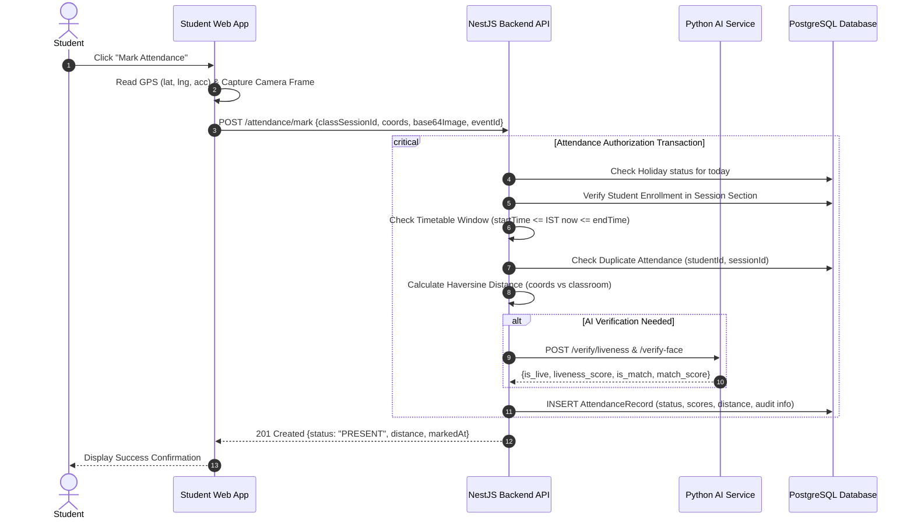

# System Architecture Specification — AEC MCA Smart Attendance Platform

## 1. Architectural Philosophy & Trust Boundaries

The system enforces authoritative institutional verification based on three physical and temporal coordinates:
1. **Who (Biometric Identity):** Live facial appearance matching against encrypted institutional enrollment templates.
2. **Where (Physical Presence):** Geolocation within the calibrated boundary of the assigned classroom.
3. **When (Academic Window):** Strict alignment with the authoritative institutional timetable and authorized faculty class session.

```
+-----------------------------------------------------------------------------------+
|                              UNTRUSTED CLIENT ZONE                                |
|  Student Browser / Mobile PWA / Faculty Client                                    |
|  - Geolocation API (coords, accuracy)                                             |
|  - MediaDevices WebRTC (Camera Video Frame)                                       |
|  - Local Storage (JWT Token, Offline Queue)                                       |
+-----------------------------------------------------------------------------------+
                                    |
                     HTTPS (REST / JWT Bearer)
                                    v
+-----------------------------------------------------------------------------------+
|                         AUTHORITATIVE SERVER ZONE (NestJS)                        |
|  Attendance Engine:                                                               |
|  - Auth & Role Guards (@Roles, JwtAuthGuard)                                      |
|  - Authoritative IST Server Time (No external API dependency)                     |
|  - Timetable Slot Validation (Mon-Sat, Semesters 1 & 3)                           |
|  - Enrollment Authorization Check (Student belongs to Section)                    |
|  - Geofence Haversine Validator (< Classroom Allowed Radius)                      |
|  - Audit Log Trail & Administrative Overrides                                     |
|  - Offline Event Reconciliation & Idempotency Pipeline                            |
+-----------------------------------------------------------------------------------+
         |                                                 |
  Internal Network (mTLS / Shared Secret)           Prisma Client (Connection Pool)
         v                                                 v
+-------------------------------+               +-----------------------------------+
|   AI VERIFICATION SERVICE     |               |       POSTGRESQL DATABASE         |
|   (FastAPI Python Microservice)|              |   - Users, Roles & Profiles       |
|   - OpenCV Face Localization  |               |   - Academic Structure            |
|   - Multi-face Rejection      |               |   - Attendance Records & Sessions |
|   - Anti-Spoofing / PAD Check |               |   - Face Templates & Audits       |
|   - Embedding Similarity      |               |   - ESP32 Hardware Credentials    |
+-------------------------------+               +-----------------------------------+
```

---

## 2. Core Service Boundaries

### 2.1 Web Frontend Client (Next.js 16)
* Client-side UI strictly presents state and captures sensor data (GPS, webcam, offline queue).
* **Security boundary:** The frontend never determines whether an attendance attempt succeeds or fails. It transmits raw sensor inputs to the authoritative NestJS API.

### 2.2 Core Backend API (NestJS 12)
* The **single source of truth** for all academic rules and attendance decisions.
* Coordinates session management, timetable lookup, enrollment checks, geofencing, database transactions, and audit records.
* Calls the AI service over a private internal channel to obtain verification scores, but **authorizes** the final attendance record itself.

### 2.3 AI Verification Microservice (Python FastAPI)
* Stateless computer vision worker.
* Performs:
  1. Image validation and normalization.
  2. Face detection and bounding box computation.
  3. Presentation Attack Detection (anti-spoofing).
  4. Embedding comparison against enrolled template.
* Returns raw confidence scores (`is_live`, `liveness_score`, `is_match`, `match_score`). Does **not** interact with the database or issue business tokens.

### 2.4 Classroom Hardware & ESP32 BLE Gateway (IoT Zone)
* Provides trusted local presence challenges for classrooms with poor indoor GPS reception.
* Emits session-bound, rotating cryptographic beacons that the student client captures and submits with the attendance payload.

---

## 3. Data Flow & Transaction Lifecycle


